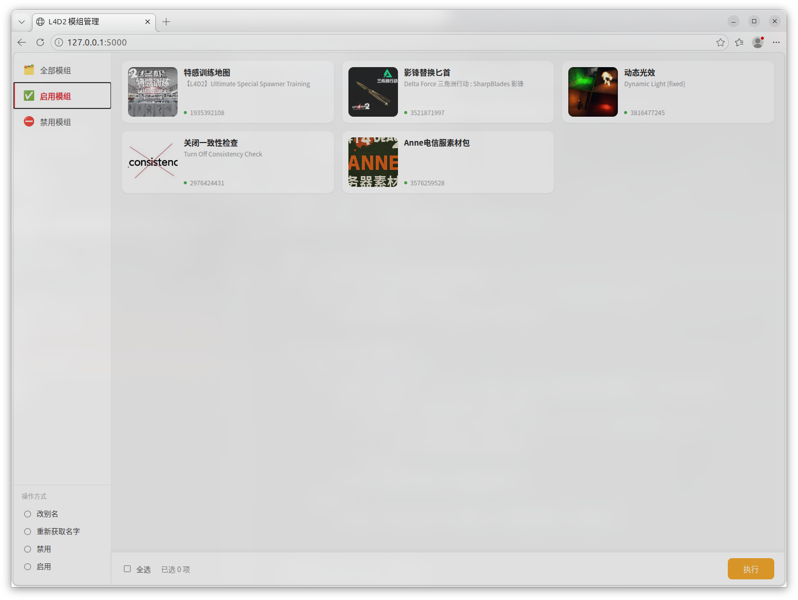

# L4D2 Mod ManagerL4D2 模组管理器

在浏览器里管理 Left 4 Dead 2 本地模组：启用/禁用、改别名、抓取创意工坊标题和预览图。



## 功能

- **全部模组**：只读浏览，显示每个模组的启用状态
- **启用 / 禁用**：勾选后把 vpk 在 `addons/` 和 `data-ban/` 之间移动
- **改别名**：勾选后输入自定义名字，显示时优先于 Steam 原名
- **重新获取名字**：从 Steam 创意工坊抓标题，同时下载预览图
- 支持批量操作和全选

## 工作原理

- 启用状态由**文件位置**决定：在 `addons/` 里是启用，在 `data-ban/` 里是禁用。
  不修改 `addonlist.txt`，不会和游戏内的启用状态互相干扰。
- `data.json` 只记录元数据（标题、别名），只增不删；已删除模组的记录会保留。
- 每次启动扫描两个目录，和 `data.json` 对齐，不联网。
- 标题和预览图来自 Steam 官方 Web API，仅在用户点"重新获取名字"时才请求。
- 写入 `data.json` 时用临时文件 + 原子替换，并保留上一版 `.bak` 备份。

## 依赖

Python 3.10+、Flask、requests

## 安装

```bash
git clone https://github.com/你的用户名/l4d2-mod-manager.git
cd l4d2-mod-manager
python -m venv venv
source venv/bin/activate
pip install -r requirements.txt
```

## 运行

```bash
python l4d2_mods_Management.py
```

然后在浏览器中打开<http://127.0.0.1:5000>

首次运行会让你填一次 addons 路径，例如：

```
~/.steam/debian-installation/steamapps/common/Left 4 Dead 2/left4dead2/addons~/.steam/debian-installation/steamapps/common/求生之路2/left4dead2/addons~/.steam/debian-installation/steamapps/common/求生之路2/left4dead2/addons~/.steam/debian-installation/steamapps/common/求生之路2/left4dead2/addons
```

或（Steam 默认安装位置）：

```
~/.local/share/Steam/steamapps/common/Left 4 Dead 2/left4dead2/addons~/.local/share/Steam/steamapps/common/求生之路2/left4dead2/addons
```

路径会写入 `config.txt`，以后不再询问。填错了就删掉 `config.txt` 重新运行一次。

## 数据目录

所有数据都在 `~/.l4d2-mod-management-data/`：

```
~/.l4d2-mod-management-data/
├── config.txt        addons 路径
├── data.json         模组记录（标题、别名）
├── data.json.bak     上一次写入前的备份
└── data-ban/         被禁用的 vpk
```

可以用环境变量改位置：

```bash巴什
export L4D2_MOD_MANAGEMENT_DATA_PATH=/mnt/d/l4d2data
```

数据会存到 `/mnt/d/l4d2data/.l4d2-mod-management-data/`。

## 预览图

预览图存放在 `addons/` 下，命名为 `{模组ID}.jpg`。点"重新获取名字"会自动下载；也可以手动放入同名文件。

## 测试环境

- Ubuntu 24.04
- Python 3.12
- Steam 正式版（非 Flatpak / Snap）

Flatpak 和 Snap 安装的 Steam 路径不同（`~/.var/app/...` 和 `~/snap/...`），理论可用但未测试。

## 注意

- 仅支持 Linux 路径
- 只使用 Steam 公开 Web API，不修改游戏文件
- 默认只绑定 `127.0.0.1`，请勿改为 `0.0.0.0` 对外开放

## License

MIT
